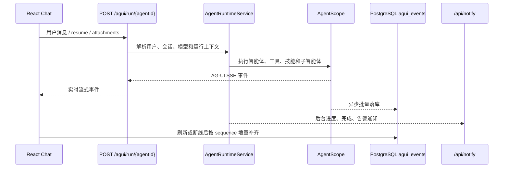

# Agent Platform Codex Guide

这份文档是本仓库的代码导航和修改约束，供 Codex 以及参与开发的工程师在执行任务前快速建立整体认知。仓库是一个基于 AgentScope Java 的智能体平台脚手架，包含 Spring Boot 后端、React 前端、数据库迁移、容器与 Helm 部署、文件型智能体定义和配套文档。

## 1. 项目定位

平台把“智能体定义、资源配置、运行时会话、流式事件、产物和运营管理”统一在一个系统里。智能体有两种来源：

- 数据库型智能体：由管理端维护 `AgentConfig`，配置和版本保存在 PostgreSQL。
- 文件型智能体：由 `workspace/agents/<目录>/AGENTS.md` 及其子目录定义，启动或重载时被扫描并映射为平台智能体。

运行时使用 AgentScope Java 2.x，统一通过 AG-UI 协议输出事件。浏览器通过 `POST /agui/run/{agentId}` 获取当前请求的 SSE 流；服务端同时把事件批量持久化到 `agui_events`，用于刷新后的增量补齐、会话转录、审计和后台任务唤醒后的结果同步。

## 2. 目录职责

```text
backend/                         Spring Boot + AgentScope Java 后端
  src/main/java/com/tipdm/agentplatform/
    config/                      配置绑定、文件型智能体装载、AgentScope 集成
    domain/                      JPA 实体、枚举和会话领域对象
    harness/                     运行时看护、中断恢复、HITL、结束契约、附件保护
    repository/                  Spring Data JPA 仓储
    service/                     智能体组装、运行、会话、知识库、技能、凭证、通知等服务
    web/                         REST 控制器、DTO、鉴权过滤器、全局异常处理
  src/main/resources/
    application.yml              默认配置和环境变量映射
    db/migration/                 Flyway 版本迁移（当前到 V62）
  workspace/                     后端默认运行工作区（实际根目录可由配置覆盖）

frontend/                        React 19 + TypeScript + Vite 前端
  src/api/                       HTTP、AG-UI、SSE、附件、知识库、技能等接口封装
  src/hooks/                     会话流、通知流、轮询、查询缓存和业务状态
  src/components/                通用组件、聊天组件、管理端组件和表单组件
  src/pages/                     admin、space、knowledge、skill、schedule 等页面
  src/lib/                       路由、权限、会话 ID、mention token 等基础逻辑

workspace/agents/                文件型智能体定义区
  <agent>/AGENTS.md              主智能体规则和工作流
  <agent>/subagents/*.md         子智能体声明
  <agent>/skills/<skill>/        技能说明、资源和脚本
  <agent>/artifacts/             运行期间生成的业务产物（默认相对路径）

docs/                            API、工作区、知识库、权限和垂类智能体规范
deploy/                           Helm Chart 和 Kubernetes 模板
docker/                           前后端、JRE、PostgreSQL 镜像定义
scripts/                          API 渲染、资源审计、迁移和进度检查脚本
docker-compose.yml               本地备用 PostgreSQL + pgvector 基础设施
```

定义区和运行区要分开理解：`workspace/agents` 是智能体定义输入，运行时会在工作区中创建会话目录、产物目录和临时状态。路径约定以 `docs/workspace-layout.md` 为准。

## 3. 后端启动与依赖

后端入口是 `backend/src/main/java/com/tipdm/agentplatform/AgentPlatformApplication.java`。应用启用 Spring Scheduling，定时任务用于通知心跳、停滞巡检、HITL 超时处理、运行租约维护、运行时工作区清理等。

主要技术栈：

- Java 21
- Spring Boot 3.5.x
- Spring Data JPA
- Flyway
- PostgreSQL 16 + pgvector
- Redis
- AgentScope Java 2.x
- SSE / AG-UI

本地启动通常是：

```bash
# 后端默认连接服务器基础设施，不需要先启动本地 Docker
# PostgreSQL: 192.168.1.245:5432 / agent_platform / agent_platform / agent_platform
# Redis:      192.168.1.245:6379，无密码
cd backend
mvn spring-boot:run

# 如需完全本地运行，再执行：docker compose up -d postgres

cd ../frontend
pnpm install
pnpm dev
```

默认端口：后端 `8080`，前端 `5174`。前端 Vite 将 `/api` 和 `/agui` 代理到后端。

数据库由 Flyway 管理，JPA 使用 `ddl-auto: validate`，因此修改实体时必须同时提供迁移 SQL，不能依赖 Hibernate 自动建表。迁移文件位于 `backend/src/main/resources/db/migration/`，当前最新版本为 `V62__session_awaiting_human_gate.sql`。

本地开发至少要确认：

- PostgreSQL 默认连接 `192.168.1.245:5432`，数据库、用户、密码均为 `agent_platform`；远端当前基线为 PG 16.15，Flyway 已到 v53，应用启动时会继续执行仓库中 v54-v62 的迁移。
- Redis 默认连接 `192.168.1.245:6379`，未设置密码，`REDIS_PASSWORD` 必须保持为空；权限码缓存和 `admin:access` 管理员判定依赖 Redis。
- `AGENT_PLATFORM_JWT_SECRET` 在需要登录时配置为足够长度的密钥。
- 外部模型、向量、搜索或 OAuth 功能按需配置对应的 API Key 和服务地址。

## 4. 配置中心

默认配置集中在 `backend/src/main/resources/application.yml`。配置分成三层：Spring 基础设施、AgentScope 运行时、`agent-platform.*` 平台业务配置。

关键配置：

- `agent-platform.workspace-root`：工作区根目录。文件型智能体从其下的 `agents/` 读取。
- `agent-platform.artifacts-dir`：智能体产物的相对目录名，默认 `artifacts`。
- `agent-platform.model`：未单独指定模型时使用的默认模型。
- `agent-platform.model-thinking`：是否启用 reasoning 通道。
- `agent-platform.model-execution.*`：单次模型调用超时和最大重试次数。
- `agent-platform.max-iters`：单次运行最大迭代次数。
- `agent-platform.plan-enabled`：默认是否启用 Plan 模式。
- `agent-platform.attachments.*`：附件内联字节数和字符数上限。
- `agent-platform.completion-contract.file-name`：声明式结束契约文件名。
- `agent-platform.declarative-ending.*`：纯文本收尾和完成契约看护。
- `agent-platform.truncation-resume.*`：输出截断后的自动续跑策略。
- `agent-platform.progress-watchdog.*`：停滞检测、自动唤醒、告警和 HITL 提醒。
- `agent-platform.hitl-timeout.*`：表单或审批等待的自动超时。
- `agent-platform.alert.*`：平台告警保留、去重和企业微信推送。
- `agent-platform.agui-event-log.*`：AG-UI 事件异步落库的队列、批量和刷盘策略。
- `agent-platform.security.allow-private-outbound`：外部请求是否允许访问私有网段，默认关闭。
- `agent-platform.external.key`：知识库外部凭据和告警凭据的 AES-256-GCM 加密密钥。
- `agent-platform.auth.*`：JWT 生命周期和 OAuth 外部认证配置。

修改配置时优先新增环境变量覆盖，不要把生产凭据写入仓库。外部加密密钥轮换会使存量密文失效，必须按现有数据迁移策略处理。

## 5. 智能体装载和组装

### 5.1 文件型智能体

`FileSystemAgentLoader` 扫描 `${workspace-root}/agents` 的一级子目录，每个目录视为一个文件型智能体。目录名被转换为稳定 UUID；包含 `AGENTS.md` 的目录才能被识别为有效智能体定义。加载时会读取：

- 主规则文件 `AGENTS.md`
- `subagents/` 下的子智能体 Markdown
- `skills/` 下的技能资产
- 工作目录和产物目录

加载器会排除配置中的目录，且会避开与数据库型智能体冲突的目录。管理端的“重载文件型智能体”会触发重新扫描。

文件型智能体的工作约束来自 Markdown 文档，因此修改垂类智能体时通常只需要修改 `workspace/agents/<name>/`，不应把垂类业务规则硬编码到 Java 服务中。

### 5.2 数据库型智能体

数据库型智能体由 `AgentConfigService`、`AgentAssemblyService`、`AgentConfigApplier` 等服务负责。配置包括模型、系统提示词、工具、技能、知识库引用、Plan 模式、HITL 表单及发布版本等。版本发布和回滚通过 `AgentConfigRevision` 及对应迁移实现。

### 5.3 统一运行时

`AguiIntegrationConfiguration` 把平台的智能体注册表、运行上下文和事件桥接到 AgentScope。`AgentRuntimeService` 负责：

1. 根据 agent ID 定位数据库型或文件型定义。
2. 解析当前用户、会话、模型、技能、知识库和工具上下文。
3. 创建或恢复会话工作区。
4. 将用户输入、附件和 resume 数据交给 AgentScope。
5. 将运行中的事件发送到 AG-UI SSE，并把事件交给持久化和通知链路。
6. 在完成、异常、中断、HITL 等状态下更新会话和运行状态。

AgentScope 标准入口是：

```text
POST /agui/run/{agentId}
```

这个端点不是普通 Controller 手写实现，而是由 AgentScope 集成自动暴露；平台通过配置类和运行时上下文解析器接入它。

## 6. 一次对话的完整链路



前端 `usePlatformMessages` 负责把 AG-UI 事件映射为消息块：用户消息、文本、思考、工具调用、工具结果、表单、产物、子智能体进度等。`frontend/src/api/agui.ts` 负责建立流和解析事件，`frontend/src/hooks/transcriptSync.ts` 以及平台接口负责在 SSE 没覆盖到的服务端自发事件出现时补齐转录。

关键行为：

- SSE 只覆盖当前浏览器主动发起的 run。
- 服务端续跑、子智能体完成、后台唤醒等事件依靠 `agui_events` 增量回放。
- 回放使用 session ID、`afterSequence` 和 limit，前端要维护水位线，避免重复渲染。
- AG-UI 事件中的 messageId / blockId 用于思考块和内容块归组，不能简单按固定条数拼接。
- 用户主动停止调用中断端点；浏览器断开连接不一定会停止后端 run，具体行为受 `interrupt-on-disconnect` 配置控制。

## 7. 会话、运行状态和看护机制

会话相关的领域对象和服务包括：

- `AgentSessionOwner`：会话归属和用户隔离。
- `AgentSessionProgress`：阶段、心跳、进度和停滞判断依据。
- `SessionLineageService`：主智能体、子智能体、续跑之间的 lineage。
- `SessionWorkspaceManager`：会话工作目录和运行时状态目录。
- `SessionCompletionContractService`：完成契约文件检查。
- `SessionTextEndingRecorder`：记录纯文本收尾阶段。
- `PendingFormInterruptStore`：HITL 表单中断和待恢复参数。
- `SessionExtensionService`、`SessionKnowledgeService`、`SubagentReportService`：会话扩展、知识库绑定和子智能体报告。

`harness/` 是运行时保护层，主要负责：

- `HitlRecoveryGuardMiddleware`：防止 HITL 恢复数据丢失。
- `HitlTimeoutReaper`：清理超时未处理的审批或表单。
- `DeclarativeEndingWatchdog`：文本看似结束但契约未完成时触发补救。
- `ExpandedAttachmentTruncationMiddleware`：限制附件展开和上下文膨胀。
- `AttachmentInlineGuardMiddleware`：控制附件内联大小。
- `AguiWakeupTarget`：为停滞或续跑任务提供唤醒目标。

修改运行状态时必须同时考虑：正常完成、模型异常、工具异常、用户中断、HITL 等待、超时、断线后继续运行、服务重启恢复、子智能体未结束和完成契约未通过等分支。

## 8. 认证、权限和请求边界

受保护路径是 `/api/**` 和 `/agui/**`。`JwtAuthFilter` 负责校验 access token 并注入认证上下文；`WebConfig` 注册全局过滤器；`JwtInterceptor` 和各控制器/服务继续执行资源级权限检查。

登录相关入口位于 `AuthController` 和 `AuthService`：

- `/api/auth/login`：委托外部 OAuth/统一认证中心校验登录信息。
- access token / refresh token：平台本地签发和续期。
- OAuth 未配置时，登录接口按配置返回不可用，不应在前端假设一定存在本地密码模式。
- 前端在 401 时通过 `frontend/src/api/client.ts` 和认证 hook 自动尝试刷新，然后重放原请求。

前端权限由外部认证下发的权限码驱动，菜单和深链分别由 `PermissionGuard`、`ProtectedRoute` 和 `frontend/src/lib/navigation.ts` 控制。后端仍是最终授权边界，前端隐藏菜单不能替代后端校验。

实现新资源时通常需要同时补齐：数据库资源/权限码、后端权限校验、前端导航和页面守卫、OpenAPI 文档，以及必要的审计字段。

## 9. REST API 分区

主要控制器和职责如下：

| 控制器 | 路径 | 职责 |
|---|---|---|
| `AuthController` | `/api/auth` | 登录、刷新、认证回调相关能力 |
| `AgentManagementController` | `/api/agents` | 智能体 CRUD、发布/回滚、文件草稿、会话、进度、HITL、清理、中断和恢复 |
| `AguiEventController` | `/api/agui-events` | 会话 AG-UI 事件的增量查询和回放 |
| `AttachmentController` | `/api/agents/{agentId}/sessions/{sessionId}/attachments` | 会话附件上传、查询、删除 |
| `SessionArtifactController` | `/api/agents/{agentId}/sessions/{sessionId}/artifacts` | 产物列表和读取 |
| `SessionExtensionController` | `/api/agents/{agentId}` | 会话扩展数据 |
| `SessionKnowledgeController` | `/api/agents/{agentId}/sessions/{sessionId}/knowledge` | 会话知识库引用和检索 |
| `SessionSubagentController` | `/api/agents/{agentId}/sessions/{sessionId}/subagents` | 子智能体状态和报告 |
| `SkillController` | `/api/skills` | 技能资源管理 |
| `SkillRepositoryController` | `/api/skill-repositories` | 技能仓库同步和管理 |
| `KnowledgeBaseController` | `/api/knowledge-bases` | 知识库、文档、切块、检索和权限 |
| `ModelCredentialController` | `/api/credentials` | 用户/平台模型凭证 |
| `ModelCatalogController` | `/api/models` | 可用模型和模型能力目录 |
| `ToolController` | `/api/tools` | 平台工具管理 |
| `ChannelController` | `/api/channels` | 通知渠道配置 |
| `NotifyStreamController` | `/api/notify` | 用户级 SSE 通知流 |
| `NotificationController` | `/api/notifications` | 通知查询和已读状态 |
| `SessionAlertPushController` | `/api/...` | 会话告警推送状态 |
| `GroupController` / `UserController` | `/api/groups` / `/api/users` | 用户、群组及授权关系 |
| `TagController` | `/api/tags` | 标签管理 |

接口详细契约以 `docs/openapi.yaml` 为准，`docs/api.md` 是阅读版。修改接口时先更新 OpenAPI，再运行仓库已有的渲染脚本生成 Markdown。

## 10. 知识库、技能、工具和模型

### 知识库

知识库链路由以下服务组成：

- `KnowledgeBaseService`：知识库和文档元数据。
- `KnowledgeIngestionService`：上传文件、抽取文本、切块和入库。
- `DocumentTextExtractor`：不同文件类型的文本抽取。
- `KnowledgeChunker`：分块策略。
- `EmbeddingClient`：向量化。
- `KnowledgeStorageService`：PostgreSQL/pgvector 持久化。
- `KnowledgeRetrievalService`、`KnowledgeTextRetrievalService`：向量或文本检索。
- `KnowledgeSearchTool`：把检索暴露为智能体工具。
- `KnowledgeBaseGrant` / `KnowledgeBasePermission`：资源级授权。

知识库的 scope、grant、pgvector 和 chunk settings 都有独立迁移，不能只改单一实体。

### 技能

技能既可以来自数据库/平台技能仓库，也可以来自文件型智能体目录。核心服务有 `SkillService`、`JpaSkillRepository`、`SkillRepositoryService`。技能资产可能包含 Markdown、资源文件和脚本，运行时需要保留来源目录和可审计关系。修改技能加载约定时同时检查 `docs/vertical-agent-dev-guide.md`、`workspace/agents/*/AGENTS.md` 和资源审计脚本。

### 工具

平台内置工具包括 shell 执行、web search、图片工具、知识库搜索和 UI 工具。`ToolExecutionMode` 以及工具配置决定工具是否需要人工确认。高风险工具要同时处理：权限、确认、超时、失败回传、重试和前端工具卡片渲染。

### 模型凭证

模型凭证支持平台共享和用户个人 scope。`ModelCredentialService`、`ModelProviderRegistry`、`VendorModelClient`、`PlatformModelDefaultService` 负责凭证解析、供应商适配、可用模型筛选和平台默认模型。新增供应商时不要把供应商判断散落在控制器中，应接入 registry/adapter 结构。

## 11. 前端结构和页面

前端入口是 `frontend/src/main.tsx`，应用组装在 `frontend/src/App.tsx`。页面分成两大区域：

- 管理端 `/admin`：智能体、技能、工具、标签、凭证、渠道、知识库、MCP 等管理。
- 用户空间 `/space`：智能体广场、会话、任务、任务结果、个人知识库、个人模型和个人设置。

主要前端模块：

- `src/api/client.ts`：统一请求、Bearer token、401 刷新和错误转换。
- `src/api/agui.ts`：AG-UI 流请求和 SSE 解析。
- `src/hooks/usePlatformMessages.ts`：把平台消息事件归组为可渲染消息块。
- `src/hooks/useNotifyStream.ts`：监听用户级后台通知。
- `src/hooks/transcriptSync.ts`：SSE 之外的会话增量同步。
- `src/components/chat/`：聊天框、消息气泡、工具调用、思考块、表单和产物渲染。
- `src/components/form/`：动态表单 schema、构建器和智能体表单字段。
- `src/lib/navigation.ts`：菜单和权限码映射。
- `src/lib/session-id.ts`：会话 ID 生成和恢复。

聊天渲染必须兼容增量事件、回放事件、重复事件和服务端续跑事件。修改事件映射时，优先复用已有的 messageId、blockId、sequence 去重和 finished 状态，不要直接按到达顺序追加字符串。

## 12. 文件型智能体开发规则

新增或修改垂类智能体时，按以下顺序检查：

1. 在 `workspace/agents/<agent>/AGENTS.md` 写清角色、输入、输出、工作流、停止条件和产物路径。
2. 子任务拆分放入 `subagents/`，每个子智能体声明输入、职责、输出文件和交接格式。
3. 可复用能力放入 `skills/<skill>/SKILL.md`，脚本和资源放在技能目录下。
4. 产物统一写入配置指定的 artifacts 目录，不要把运行结果写回定义文件。
5. 需要前端交互时使用平台约定的动态表单、UI 卡片、进度和 HITL 机制。
6. 需要知识检索时通过平台知识库工具或文档约定接入，不要把外部密钥硬编码进智能体 Markdown。
7. 变更后运行资源审计和相关脚本，确认引用的技能、文件和产物模板都存在。

仓库中的 `workspace/agents/旅行规划师`、`数据分析助手`、`会议纪要助手`、`教材开发小助手` 是文件型智能体样例，也是理解子智能体、技能和产物约定的最佳入口。

## 13. 数据库迁移原则

迁移文件按 `V<number>__description.sql` 命名。新增表或字段时：

- 先确认现有实体、索引、外键和 scope 设计。
- 新建单调递增版本，禁止改写已执行的历史迁移。
- 同步更新实体、repository、service、DTO、控制器和 OpenAPI。
- 对权限、用户隔离、归档、审计和删除策略写出明确 SQL 约束。
- 关注 PostgreSQL/pgvector 扩展、JSON 字段、时间类型和并发唯一性。
- 在本地用干净数据库和已有数据库各执行一次迁移验证。

当前迁移已经覆盖：认证用户、工具执行模式、Plan、技能、AG-UI、会话归属/进度/归档、知识库及向量、运行租约、通知、渠道、模型凭证、标签、模型默认值、智能体发布版本、文件草稿、停止请求、文本收尾和 HITL 等待状态。

## 14. 修改代码时的边界和检查点

### 后端

- Controller 只做 HTTP 参数、权限入口和 DTO 编排，业务放 service。
- 会话运行相关改动必须检查 `AgentRuntimeService`、`SessionProgressService`、`AguiEventPersistenceService`、`SessionCompletionContractService` 和 `harness/`。
- 任何新异步任务都要考虑线程池、租约、幂等、重试、应用重启和告警。
- 所有用户可访问资源都要验证 owner、scope、grant 或平台权限。
- 文件路径必须经过规范化和越界校验，避免工作区逃逸和路径泄露。
- 外部 HTTP 请求遵守私有网段限制和超时策略。

### 前端

- 先更新 API 类型和接口封装，再改 hook 和页面。
- 新增路由同步修改权限菜单、深链守卫、国际化和错误页面。
- 流式 UI 必须验证首包、增量、结束、错误、断线、重复和回放。
- 不要在组件中重复实现 token 刷新、session ID、事件去重或权限判断。
- 管理端和用户空间的资源范围不同，不能复用一个查询而省略 scope 参数。

### 文档

- OpenAPI 是接口唯一权威来源。
- `docs/README.md` 是文档索引。
- `docs/workspace-layout.md`、`docs/vertical-agent-dev-guide.md`、`docs/form-config-contract.md` 解释智能体接入、工作区和动态表单契约。
- 代码行为发生变化时，至少同步更新对应 API、配置、运行协议或开发指南。

## 15. 常用排查路径

### 页面能打开但聊天没有输出

按顺序检查：

1. 浏览器请求是否命中 `/agui/run/{agentId}`，而不是错误的 `/api` 路径。
2. access token 是否过期，刷新请求是否成功。
3. 后端日志是否出现 agent registry、模型凭证或模型调用异常。
4. AgentScope SSE 是否建立，是否有 `RUN_STARTED` / message start 事件。
5. `agui_events` 是否落库，若落库但前端无显示，检查事件解析和 messageId 归组。
6. `useNotifyStream` 或 transcript sync 是否把后台事件合并进当前会话。

### 智能体找不到

- 数据库型：检查 agent 是否发布、状态是否可用、当前用户是否有权限。
- 文件型：检查 `workspace-root/agents/<dir>/AGENTS.md` 是否存在、目录是否被 `exclude-folders` 排除、是否需要执行 reload。
- 两类都要检查模型配置是否存在，因为文件型智能体没有独立模型时使用平台默认模型。

### 运行卡住

检查 `AgentSessionProgress`、run lease、最后一条 `agui_events`、HITL 待处理表单、完成契约文件和停滞看护日志。不要只看浏览器连接是否还活着；后台 run 可能仍在继续。

### 产物丢失

确认智能体写入了 `agent-platform.artifacts-dir` 下的会话工作区，并通过 `SessionArtifactController` 暴露；不要只检查定义目录是否出现文件。

## 16. Codex 执行任务时的推荐流程

1. 先读取根目录 `README.md`、本文件和相关 `docs/*`，确认约定。
2. 用 `rg` 定位路由、service、实体、迁移和前端 hook，不要先大范围改文件。
3. 先画清请求链路和数据边界，再修改最小范围代码。
4. 涉及数据库先写迁移，再同步实体和 API。
5. 涉及流式事件先同时检查后端事件生产、落库、前端解析、回放和去重。
6. 涉及文件型智能体先检查定义区和资源审计，不要把规则挪到平台代码。
7. 执行与改动匹配的验证：后端编译/测试、前端 lint/build、迁移验证、脚本审计或接口检查。
8. 最终说明修改了什么、验证了什么、还有哪些依赖外部服务的限制。

常用验证命令：

```bash
cd backend
mvn test
mvn -DskipTests package

cd ../frontend
pnpm lint
pnpm build

cd ..
python scripts/audit_skill_assets.py
python scripts/render_api_md.py
```

如果任务只修改文档，不需要为了形式运行完整构建；至少要检查 Markdown 链接、路径、命令、配置键和版本号与仓库现状一致。

## 17. 关键文件索引

- `README.md`：项目面向开发者的总览和本地启动说明。
- `backend/src/main/resources/application.yml`：后端配置源。
- `backend/src/main/java/com/tipdm/agentplatform/config/AguiIntegrationConfiguration.java`：AG-UI 集成入口。
- `backend/src/main/java/com/tipdm/agentplatform/config/FileSystemAgentLoader.java`：文件型智能体扫描与装载。
- `backend/src/main/java/com/tipdm/agentplatform/service/AgentRuntimeService.java`：运行时编排核心。
- `backend/src/main/java/com/tipdm/agentplatform/service/AgentAssemblyService.java`：智能体组装。
- `backend/src/main/java/com/tipdm/agentplatform/service/AguiEventPersistenceService.java`：事件异步持久化。
- `backend/src/main/java/com/tipdm/agentplatform/harness/`：运行时看护与恢复。
- `backend/src/main/java/com/tipdm/agentplatform/web/AgentManagementController.java`：管理端和会话 REST 主入口。
- `backend/src/main/java/com/tipdm/agentplatform/web/auth/`：JWT、拦截器和 Web 配置。
- `backend/src/main/resources/db/migration/`：数据库演进历史。
- `frontend/src/api/agui.ts`：AG-UI 客户端。
- `frontend/src/hooks/usePlatformMessages.ts`：事件到消息模型的核心转换。
- `frontend/src/hooks/useNotifyStream.ts`：用户级后台通知 SSE。
- `frontend/src/lib/navigation.ts`：前端菜单和权限码。
- `docs/openapi.yaml`：接口权威契约。
- `docs/workspace-layout.md`：定义区/运行区路径契约。
- `docs/vertical-agent-dev-guide.md`：垂类智能体接入规范。

这份文档描述的是当前代码结构和运行逻辑。实现与文档冲突时，以实际代码、数据库迁移和 `docs/openapi.yaml` 为准，并在修复后同步更新本文件。


